# JPet Store 微服务化改造 实验报告

> 依据：当前仓库代码（2026-11-04 快照），五个模块：`pet-shop-common`、`user-service`、`pet-shop-backend`（product-service）、`order-service`、`gateway`。
> 说明：本文所有类、接口、字段、路径均来自现有代码；JSON 字段采用 Boot 的 SNAKE_CASE 策略（Java 驼峰 `accessToken` ↔ JSON `access_token`）。


---

# 第一部分：类图设计

## 1. 总体架构与依赖

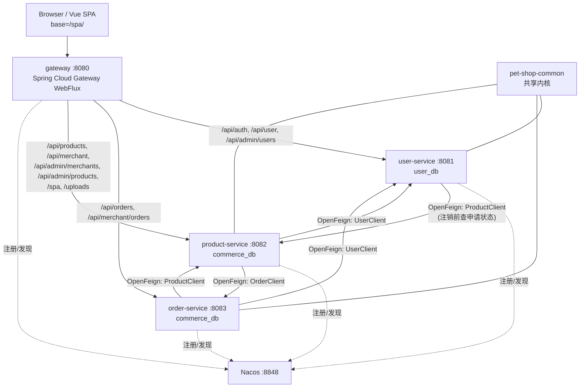

**模块与端口**

| 模块/目录 | Nacos 服务名 | 端口 | 数据库 | 职责 |
|---|---|---|---|---|
| `user-service/` | `user-service` | 8081 | `user_db` | 注册/登录/刷新、用户资料、管理员-用户、账号注销 |
| `pet-shop-backend/` | `product-service` | 8082 | `commerce_db` | 商品/商家/认证/标签、SPA、uploads |
| `order-service/` | `order-service` | 8083 | `commerce_db` | 下单、订单、评价、商家订单、Saga 补偿 |
| `gateway/` | `gateway` | 8080 | — | 统一路由、服务名负载均衡 |
| `pet-shop-common/` | — | — | — | Result/JWT/异常/MyBatis/内部令牌 |

> 所有业务服务使用同一基础包 `com.edu.csu.web.pet_shop_backend`，通过 Maven 模块隔离；gateway 使用 `com.edu.csu.web.gateway`，不依赖 common，避免 Servlet/WebFlux 冲突。

---

## 2. 公共内核 `pet-shop-common`

### 2.1 类图

```mermaid
classDiagram
    class Result~T~ {
        +int code
        +String message
        +T data
        +Map metadata
        +success(T)
        +success(String,T)
        +fail(int,String)
    }
    class PageResult~T~ {
        +Long total
        +List list
    }
    class JwtUtil {
        +generateAccessToken(Long,String,UserRoleEnum)
        +generateRefreshToken(Long,String,UserRoleEnum)
        +parseToken(String)
        +getUserId(Claims)
        +getRole(Claims)
    }
    class PasswordUtil {
        +encode(String)
        +matches(String,String)
    }
    class JWTUserContext {
        +Long userId
        +UserRoleEnum role
        +String username
    }
    class JWTContextHolder {
        +setContext(JWTUserContext)
        +getContext()
        +clearContext()
    }
    class UserRoleEnum {
        <<enumeration>>
        NORMAL_USER
        MERCHANT_USER
        MAIN_ADMIN
        SUB_ADMIN
    }
    class AppException {
        <<abstract>>
        +int code
        +String errorType
        +Map data
    }
    class BusinessException {
        +badRequest(String)
        +unauthorized(String)
        +forbidden(String)
        +notFound(String)
        +conflict(String)
    }
    class GlobalExceptionHandler {
        +handleAppException()
        +handleBusinessException()
        +handleMethodArgumentNotValidException()
        +handleHandlerMethodValidationException()
        +handleException()
    }
    class JWTAuthenticationFilter {
        +doFilterInternal()
    }
    class InternalTokenFilter {
        +doFilterInternal()
    }
    class InternalTokenFeignInterceptor {
        +apply(RequestTemplate)
    }
    class JwtArgumentResolverConfig {
        +addArgumentResolvers()
    }
    class JWTUserContextMethodArgumentResolver {
        +supportsParameter()
        +resolveArgument()
    }
    class MybatisPlusConfig {
        +mybatisPlusInterceptor()
    }
    class MybatisMetaObjectHandler {
        +insertFill()
        +updateFill()
    }
    class AppConfig {
        +objectMapper()
    }
    class AdminJWTContextValidator {
        +requireAdmin(JWTUserContext)
    }
    class UserBriefVo {
        +Long id
        +String username
        +String email
        +String role
        +String status
        +String profile
    }
    class InjectJWTUserContext {
        <<annotation>>
    }

    AppException <|-- BusinessException
    GlobalExceptionHandler ..> Result : returns
    GlobalExceptionHandler ..> AppException : handles
    GlobalExceptionHandler ..> BusinessException : handles
    JWTAuthenticationFilter ..> JwtUtil : parses
    JWTAuthenticationFilter ..> JWTContextHolder : sets
    JWTUserContextMethodArgumentResolver ..> JWTContextHolder : reads
    JwtArgumentResolverConfig ..> JWTUserContextMethodArgumentResolver : registers
    InternalTokenFeignInterceptor ..> InternalTokenFilter : header contract
```

### 2.2 职责说明

| 类 | 职责 | 关键点 |
|---|---|---|
| `Result<T>` | 统一外部/内部响应信封 | `code/message/data/metadata`；业务错误通常仍返回 HTTP 200，错误码在 `code` |
| `Constant.Result<T>` | 旧版统一响应（部分管理员/认证接口使用） | `success(T)`、`success()`、`error(code,msg)`；`metadata` 可能为 null |
| `Constant.PageResult<T>` | 管理端分页 | `total`、`list` |
| `JwtUtil` | 生成/解析 JWT | claims：`userId`、`userName`、`role`、`type`(access/refresh) |
| `PasswordUtil` | BCrypt 密码 | 注册加密、登录校验 |
| `JWTUserContext` | 当前请求用户上下文 | `userId/role/username` |
| `JWTContextHolder` | ThreadLocal 保存上下文 | 过滤器写入，参数解析器读取 |
| `UserRoleEnum` | 角色枚举 | `normal_user`、`merchant_user`、`main_admin`、`sub_admin` |
| `AppException` | 带 `errorType` 的业务异常基类 | 子类：账号状态、注册冲突、凭证无效、商品不存在等 |
| `BusinessException` | 轻量业务异常 | 400/401/403/404/409 |
| `GlobalExceptionHandler` | 全局异常统一响应 | 参数校验 → `data` 字段错误映射 |
| `JWTAuthenticationFilter` | 解析 Bearer token，写入 SecurityContext/ThreadLocal | `/api/merchant/**`、`/api/admin/**` 无 token 直接 401 |
| `InternalTokenFilter` | 校验 `/internal/**` 的 `X-Internal-Token` | fail-closed；token 未配置返回 503 |
| `InternalTokenFeignInterceptor` | Feign 请求自动加 `X-Internal-Token` | 在 product/order/user 的 `FeignConfig` 注册 |
| `JwtArgumentResolverConfig` | 注册 `@InjectJWTUserContext` 解析器 | 三个 MVC 服务共用 |
| `MybatisPlusConfig` | MyBatis-Plus 分页插件 | 所有服务共用 |
| `MybatisMetaObjectHandler` | 自动填充 createTime/updateTime | 实体 `@TableField(fill=...)` |
| `AppConfig` | Jackson 2 ObjectMapper | 设为 SNAKE_CASE + JavaTimeModule，保证 Feign 与 MVC 命名一致 |
| `AdminJWTContextValidator` | 管理员角色校验 | 控制器入口显式调用 |
| `UserBriefVo` | 内部用户快照 | product/order 通过 Feign 读取 |

---

## 3. user-service 类图

### 3.1 类图

```mermaid
classDiagram
    class AuthController {
        +registerUser(UserRegisterDto)
        +registerAdmin(AdminRegisterDto)
        +loginMerchant(MerchantLoginDto)
        +loginAdmin(AdminLoginDto)
        +refreshToken(TokenRefreshDto)
    }
    class UserProfileController {
        +getProfile()
        +updateProfile(UserProfileUpdateDto)
        +deleteAccount()
    }
    class AdminUserController {
        +getUsers(page,size,userId,username,email,role,status)
        +getUserById(id)
        +updateUserStatus(id,UserStatusUpdateDto)
    }
    class InternalUserController {
        +get(id)
        +batch(ids)
        +patch(id,InternalUserPatchDto)
    }

    class AuthService {
        +registerUser(UserRegisterDto)
        +registerAdmin(AdminRegisterDto)
        +loginMerchant(MerchantLoginDto)
        +loginAdmin(AdminLoginDto)
        +refreshAccessToken(TokenRefreshDto)
    }
    class UserProfileService {
        +getProfileForCurrentUser(Long)
        +updateProfileForCurrentUser(UserProfileUpdateDto,Long)
    }
    class AdminUserService {
        +getUsersPage(Integer,Integer,Integer,String,String,String,String)
        +getUserDetail(Long)
        +updateUserStatus(Long,String)
    }
    class InternalUserService {
        +get(Long)
        +batch(List)
        +patch(Long,InternalUserPatchDto)
    }
    class AccountDeletionService {
        +deleteAccount(Long)
    }

    class AuthServiceImpl
    class UserProfileServiceImpl
    class AdminUserServiceImpl
    class InternalUserServiceImpl

    class UserMapper
    class AdministratorMapper
    class User {
        +Long id
        +String username
        +String email
        +String password
        +String role
        +String status
        +String profile
    }
    class Administrator {
        +Long id
        +String account
        +String password
        +String role
    }

    class ProductClient {
        +applicationStatus(Long)
    }
    class JwtUtil
    class PasswordUtil
    class UserBriefVo

    class SecurityConfig
    class UserSchemaUpgradeRunner
    class DefaultAdminInitializer
    class FeignConfig

    AuthController --> AuthService
    UserProfileController --> UserProfileService
    UserProfileController --> AccountDeletionService
    AdminUserController --> AdminUserService
    InternalUserController --> InternalUserService

    AuthServiceImpl ..|> AuthService
    UserProfileServiceImpl ..|> UserProfileService
    AdminUserServiceImpl ..|> AdminUserService
    InternalUserServiceImpl ..|> InternalUserService

    AuthServiceImpl --> UserMapper
    AuthServiceImpl --> AdministratorMapper
    AuthServiceImpl --> JwtUtil
    AuthServiceImpl --> PasswordUtil
    UserProfileServiceImpl --> UserMapper
    AdminUserServiceImpl --> UserMapper
    InternalUserServiceImpl --> UserMapper
    AccountDeletionService --> UserMapper
    AccountDeletionService --> PasswordUtil
    AccountDeletionService --> ProductClient : Feign

    UserMapper --> User
    AdministratorMapper --> Administrator
    InternalUserServiceImpl ..> UserBriefVo
    DefaultAdminInitializer --> AdministratorMapper
    FeignConfig ..> InternalTokenFeignInterceptor
```

### 3.2 关系说明

| 关系 | 说明 |
|---|---|
| Controller → Service | 控制器只做参数接收/上下文解析，业务在 Service |
| AuthServiceImpl → UserMapper/AdministratorMapper | 普通用户与管理员分表 |
| AccountDeletionService → ProductClient | 注销前通过 product-service 查 pending/rejected 商家申请 |
| InternalUserController → InternalUserService → UserMapper | 供 product/order 通过 Feign 读取/更新用户 |
| `UserBriefVo` | 内部接口返回，不直接暴露给前端 |
| `SecurityConfig` | `/api/auth/**` 放行；`/api/user/profile` 用户角色；`/api/admin/users/**` 管理员 |
| `UserSchemaUpgradeRunner` | 兼容旧库，把 `status` 枚举扩到 `deleted` |

---

## 4. product-service 类图

为可读性拆成三组：商品域、商家域、内部商品/库存域。

### 4.1 商品域

```mermaid
classDiagram
    class BuyerProductController {
        +listProducts(category,search)
        +getProduct(id)
        +listCategories()
        +listSuggestions(keyword)
    }
    class ProductController {
        +listProduct(ProductListDto)
        +getProductDetail(id)
        +createProduct(ProductSpuCreateDto)
        +uploadProductImage(file)
        +createProductSku(List)
        +updateProduct(ProductSpuUpdateDto)
        +updateProductSkus(List)
        +deleteProductSpu(spuId)
        +deleteProductSku(skuId)
        +deleteProductSpus(spuIds)
        +deleteProductSkus(skuIds)
        +getTagUsing()
    }
    class AdminProductController {
        +getPendingProducts(page,size)
        +getProductDetail(id)
        +auditProduct(id,ProductAuditDto)
    }

    class BuyerProductService {
        +listProducts(String,String)
        +getProductDetail(Long)
        +listCategories()
        +listSuggestions(String)
    }
    class ProductService {
        +listProducts(ProductListDto,Long)
        +getProductDetail(Long,Long)
        +createProduct(ProductSpuCreateDto,Long)
        +createProductSkus(List,Long)
        +updateProduct(ProductSpuUpdateDto,Long)
        +updateProductSkus(List,Long)
        +deleteProductSpus(List,Long)
        +deleteProductSkus(List,Long)
        +deleteSingleSku(Long,Long)
        +getUsingTags(Long)
    }
    class AdminProductService {
        +getPendingProductsPage(Integer,Integer)
        +getProductDetail(Long)
        +auditProduct(Long,ProductAuditDto)
    }
    class TagService {
        +ensureTagsExist(List)
        +syncSpuTags(Long,List)
        +getTagNamesBySpuIds(List)
    }

    class BuyerProductServiceImpl
    class ProductServiceImpl
    class AdminProductServiceImpl
    class TagServiceImpl

    class ProductSPUMapper
    class ProductSKUMapper
    class ProductSpuTagRelMapper
    class TagMapper

    class ProductSPU {
        +Long id
        +Long merchantId
        +String name
        +String imageUrl
        +String status
        +Integer isActive
        +BigDecimal minPrice
        +Integer sales
        +JsonNode coreAttributes
    }
    class ProductSKU {
        +Long id
        +Long spuId
        +JsonNode attributeValues
        +String status
        +Integer isActive
        +BigDecimal price
        +Integer stock
    }
    class Tag {
        +Long id
        +String name
    }
    class ProductSpuTagRel {
        +Long id
        +Long spuId
        +Long tagId
    }
    class BaseProductSPU {
        +Long id
        +String name
        +String imageUrl
        +BigDecimal minPrice
        +Integer sales
    }

    class UserDirectory
    class OrderDirectory

    BuyerProductController --> BuyerProductService
    ProductController --> ProductService
    AdminProductController --> AdminProductService

    BuyerProductServiceImpl ..|> BuyerProductService
    ProductServiceImpl ..|> ProductService
    AdminProductServiceImpl ..|> AdminProductService
    TagServiceImpl ..|> TagService

    BuyerProductServiceImpl --> ProductSPUMapper
    BuyerProductServiceImpl --> ProductSKUMapper
    BuyerProductServiceImpl --> ProductSpuTagRelMapper
    BuyerProductServiceImpl --> TagMapper
    BuyerProductServiceImpl --> OrderDirectory : Feign ratings
    BuyerProductServiceImpl --> UserDirectory : Feign reviewers

    ProductServiceImpl --> ProductSPUMapper
    ProductServiceImpl --> ProductSKUMapper
    ProductServiceImpl --> ProductSpuTagRelMapper
    ProductServiceImpl --> TagMapper
    ProductServiceImpl --> TagService
    ProductServiceImpl --> UserDirectory : Feign
    ProductServiceImpl --> OrderDirectory : Feign reviews

    AdminProductServiceImpl --> ProductSPUMapper
    AdminProductServiceImpl --> ProductSKUMapper
    AdminProductServiceImpl --> ProductSpuTagRelMapper
    AdminProductServiceImpl --> TagMapper

    ProductSPUMapper --> ProductSPU
    ProductSKUMapper --> ProductSKU
    ProductSpuTagRelMapper --> ProductSpuTagRel
    TagMapper --> Tag
    BuyerProductService ..> BaseProductSPU
    BuyerProductService ..> BuyerProductVo
    ProductService ..> ProductDetailVo
    ProductService ..> ProductListVo
```

> 说明：`BuyerProductServiceImpl` 的评分来自 `OrderDirectory.ratings(...)`（order-service）；`ProductServiceImpl` 的评价来自 `OrderDirectory.reviews(...)`；评价人昵称来自 `UserDirectory.batch(...)`。product-service 已不再直接访问 order 表。

### 4.2 商家域

```mermaid
classDiagram
    class MerchantApplicationController {
        +applyMerchant(MerchantApplyDto)
        +withdrawApplication()
        +getCurrentApplicationStatus()
        +uploadMerchantApplyImage(file)
    }
    class MerchantProfileController {
        +getProfile()
        +updateProfile(MerchantProfileUpdateDto)
        +uploadAvatar(file)
    }
    class MerchantStatsController {
        +getStats()
    }
    class MerchantAuthenticationController {
        +applyOfficialAuthentication(MerchantAuthenticationApplyDto)
        +listCurrentMerchantAuthentications()
        +deleteAuthentication(id)
        +uploadAuthenticationImage(file)
    }
    class AdminMerchantController {
        +getPendingMerchants(page,size)
        +auditMerchant(id,MerchantAuditDto)
    }
    class AdminAuthenticationController {
        +getPendingAuthentications(page,size)
        +getAuthentications(merchantId)
        +auditAuthentication(id,AdminAuthenticationAuditDto)
    }

    class MerchantApplicationService {
        +applyMerchant(MerchantApplyDto,Long)
        +getCurrentApplicationStatus(Long)
        +withdrawApplication(Long)
    }
    class MerchantProfileService {
        +getProfileForCurrentUser(Long,String)
        +updateProfileForCurrentUser(MerchantProfileUpdateDto,Long,String)
        +updateAvatarForCurrentUser(String,Long,String)
        +getStatsForCurrentUser(Long)
    }
    class MerchantAuthenticationService {
        +applyOfficialAuthentication(Long,MerchantAuthenticationApplyDto)
        +listCurrentMerchantAuthentications(Long)
        +deleteAuthentication(Long,Long)
    }
    class AdminMerchantService {
        +getPendingMerchantsPage(Integer,Integer)
        +auditMerchant(Long,MerchantAuditDto)
    }
    class AdminAuthenticationService {
        +getAuthenticationsByMerchantId(Integer)
        +getPendingAuthenticationsPage(Integer,Integer)
        +auditAuthentication(Long,AdminAuthenticationAuditDto)
    }
    class MerchantCacheService {
        +getMerchantIdByUserId(Long)
    }

    class MerchantApplicationServiceImpl
    class MerchantProfileServiceImpl
    class MerchantAuthenticationServiceImpl
    class AdminMerchantServiceImpl
    class AdminAuthenticationServiceImpl
    class MerchantCacheServiceImpl

    class MerchantMapper
    class MerchantTagRelMapper
    class MerchantAuthenticationMapper
    class ProductSPUMapper
    class TagService

    class Merchant {
        +Long id
        +Long userId
        +String merchantName
        +String imageUrl
        +BigDecimal turnover
        +String description
        +String status
        +String auditReason
    }
    class MerchantAuthentication {
        +Long id
        +Long merchantId
        +String authenticationName
        +String companyName
        +String certificateImageUrl
        +String status
        +String auditReason
        +String authLevel
        +LocalDate validUntil
    }
    class MerchantTagRel {
        +Long id
        +Long merchantId
        +Long tagId
    }

    class UserDirectory
    class OrderDirectory

    MerchantApplicationController --> MerchantApplicationService
    MerchantProfileController --> MerchantProfileService
    MerchantStatsController --> MerchantProfileService
    MerchantAuthenticationController --> MerchantAuthenticationService
    AdminMerchantController --> AdminMerchantService
    AdminAuthenticationController --> AdminAuthenticationService

    MerchantApplicationServiceImpl ..|> MerchantApplicationService
    MerchantProfileServiceImpl ..|> MerchantProfileService
    MerchantAuthenticationServiceImpl ..|> MerchantAuthenticationService
    AdminMerchantServiceImpl ..|> AdminMerchantService
    AdminAuthenticationServiceImpl ..|> AdminAuthenticationService

    MerchantApplicationServiceImpl --> MerchantMapper
    MerchantApplicationServiceImpl --> MerchantTagRelMapper
    MerchantApplicationServiceImpl --> MerchantAuthenticationMapper : orphan guard
    MerchantApplicationServiceImpl --> ProductSPUMapper : orphan guard
    MerchantApplicationServiceImpl --> UserDirectory : Feign
    MerchantApplicationServiceImpl --> TagService

    MerchantProfileServiceImpl --> MerchantMapper
    MerchantProfileServiceImpl --> MerchantTagRelMapper
    MerchantProfileServiceImpl --> ProductSPUMapper
    MerchantProfileServiceImpl --> UserDirectory : Feign
    MerchantProfileServiceImpl --> OrderDirectory : Feign
    MerchantProfileServiceImpl --> TagService

    MerchantAuthenticationServiceImpl --> MerchantMapper
    MerchantAuthenticationServiceImpl --> MerchantAuthenticationMapper
    AdminMerchantServiceImpl --> MerchantMapper
    AdminMerchantServiceImpl --> UserDirectory : Feign role sync
    AdminAuthenticationServiceImpl --> MerchantAuthenticationMapper
    MerchantCacheServiceImpl --> MerchantMapper

    MerchantMapper --> Merchant
    MerchantAuthenticationMapper --> MerchantAuthentication
    MerchantTagRelMapper --> MerchantTagRel
```

### 4.3 内部商品/库存域

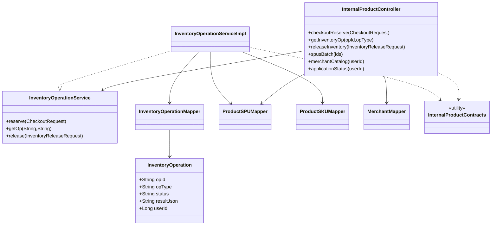

### 4.4 辅助配置

| 类 | 职责 |
|---|---|
| `ProductConfig` | 手工装配 `ProductService`、`TagService`、`MerchantCacheService`、Caffeine CacheManager |
| `SecurityConfig` | 商家/管理员接口鉴权；`/api/merchant/apply` 双角色；`/internal/**` 交给 `InternalTokenFilter` |
| `WebConfig` | `/spa/**`、`/uploads/**` 静态资源；SPA history fallback |
| `SchemaUpgradeRunner` | 兼容旧库：merchant_authentication 列 + `inventory_op_tb` |
| `ProductUploadProperties` | `product.upload.dir/publicPath` |
| `FeignConfig` | 注册 `InternalTokenFeignInterceptor`、`JacksonEncoder/Decoder`、JSON Content-Type |

---

## 5. order-service 类图

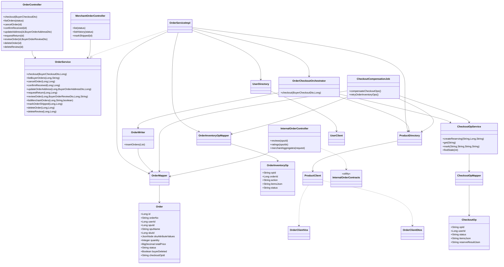

**关键关系**

| 关系 | 说明 |
|---|---|
| `OrderServiceImpl` → `OrderCheckoutOrchestrator` | 下单不再在 Service 内直接跨服务，而是交给编排器 |
| `OrderCheckoutOrchestrator` → `ProductDirectory` | Feign 调 product-service 扣库存 |
| `OrderCheckoutOrchestrator` → `CheckoutOpService` | 写 `checkout_op_tb` 状态机 |
| `OrderCheckoutOrchestrator` → `OrderWriter` | 本地事务写 `order_tb`（`checkoutOpId`） |
| `OrderServiceImpl` → `ProductDirectory` | 订单展示/商家订单/发货校验读取 product 快照 |
| `OrderServiceImpl` → `UserDirectory` | 买家/商家用户快照 |
| `CheckoutCompensationJob` | 扫描 `checkout_op_tb`、`order_inventory_op_tb` 做补偿/重试 |
| `InternalOrderController` | 供 product-service 读取评价/评分/营收聚合 |

---

## 6. gateway

gateway 没有业务类，只有启动类 + 路由配置。启动类：

```java
@SpringBootApplication
@EnableDiscoveryClient
public class GatewayApplication
```

路由配置在 `gateway/src/main/resources/application.yml`，前缀为 `spring.cloud.gateway.server.webflux.routes`（SCG 5.x）。路由表见第二部分 2.2。

---

## 7. 数据库实体关系（逻辑外键，无物理 FK）

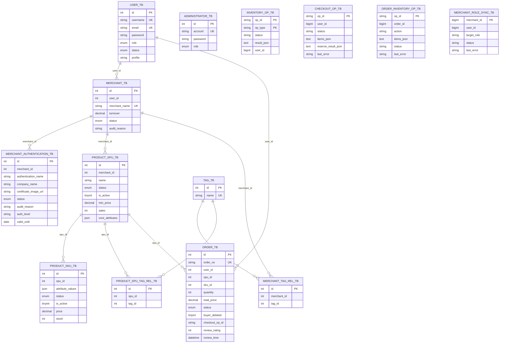

> `user_tb`/`administrator_tb` 在 `user_db`；其余表在 `commerce_db`。跨 schema 只存逻辑 ID，没有物理外键。

---

# 第二部分：API 接口文档

## 1. 通用约定

### 1.1 Base URL 与端口

- 外部统一入口：`http://localhost:8080`
- 服务直连（仅调试/对比）：user `8081`、product `8082`、order `8083`
- 正式调用只走 8080；8081/8082/8083 不对外暴露
- 截图说明：第三部分因本机端口占用使用 18080-18083；代码默认配置仍为 8080-8083，服务名/路由不变

### 1.2 响应信封

普通业务接口：

```json
{
  "code": 200,
  "message": "Success",
  "data": {},
  "metadata": {}
}
```

- `code`：业务状态码（200 成功；400/401/403/404/409/500 失败）
- `message`：提示信息
- `data`：业务数据；失败时可能为 `null` 或字段错误 Map
- `metadata`：附加元数据；部分使用 `Constant.Result` 的接口可能为 `null`

分页接口（管理员列表）：

```json
{
  "code": 200,
  "message": "Success",
  "data": { "total": 10, "list": [] },
  "metadata": null
}
```

### 1.3 HTTP 状态 vs `Result.code`

- 业务成功/业务失败：HTTP 通常为 **200**，真实状态在 `Result.code`
- Spring Security 未登录/无权限：HTTP **401/403**，body 仍是 `Result`
- 参数校验失败：HTTP **200**，`Result.code=400`，`data` 为字段错误
- 内部令牌缺失/错误：`/internal/**` 直接 HTTP **401**；token 未配置 HTTP **503**

### 1.4 鉴权

- JWT：`Authorization: Bearer <access_token>`
- access token 默认 2 小时；refresh token 默认 7 天
- JWT claims：`userId`、`userName`、`role`、`type`（access/refresh）
- 角色：`normal_user`、`merchant_user`、`main_admin`、`sub_admin`
- 内部接口：`X-Internal-Token: jpet-internal-2026`；网关不路由 `/internal/**`

### 1.5 JSON 命名与时间

- 实际 JSON 字段为 **snake_case**（Boot 的 `spring.jackson.property-naming-strategy: SNAKE_CASE`）
- 下文 DTO/VO 字段用 Java 驼峰表示，例如 `accessToken` 对应 JSON `access_token`
- `LocalDateTime` 字段通常为 ISO-8601：`2026-11-04T19:50:30`
- 部分 VO 使用预格式化 String：`2026-11-04 19:50:30`（如订单 `createdAt`）

### 1.6 错误码与 `errorType`

| code | 含义 | 常见 `errorType` |
|---|---|---|
| 200 | 成功 | — |
| 400 | 参数/业务非法 | `PRODUCT_CREATE_INVALID`、`PRODUCT_UPDATE_INVALID`、`参数校验失败` |
| 401 | 未登录/凭证无效 | `AUTH_CREDENTIALS_INVALID`、`LOGIN_INVALID` |
| 403 | 无权限/账号状态异常 | `ACCOUNT_STATUS_INVALID`、`MERCHANT_NOT_FOUND`、`ADMIN_REGISTER_KEY_INVALID` |
| 404 | 资源不存在 | `PRODUCT_NOT_FOUND` |
| 409 | 冲突 | `USER_REGISTER_CONFLICT`、`ADMIN_REGISTER_CONFLICT`、`MERCHANT_APPLY_CONFLICT` |
| 500 | 系统异常 | — |

---

## 2. 网关路由

| 路径 | 目标服务 | 说明 |
|---|---|---|
| `/api/auth/**` | `user-service` | 注册/登录/刷新 |
| `/api/user/**` | `user-service` | 用户资料/注销 |
| `/api/admin/users/**` | `user-service` | 管理员-用户 |
| `/api/merchant/orders/**` | `order-service` | 商家订单（必须优先于 `/api/merchant/**`） |
| `/api/orders/**` | `order-service` | 买家订单 |
| `/api/products/**` | `product-service` | 买家商品 |
| `/api/merchant/**` | `product-service` | 商家商品/资料/申请/认证 |
| `/api/admin/merchants/**` | `product-service` | 管理员-商家/认证 |
| `/api/admin/products/**` | `product-service` | 管理员-商品 |
| `/api/cart/**` | `product-service` | 遗留调用，无控制器，保持 404 |
| `/spa`、`/spa/**`、`/uploads/**` | `product-service` | SPA 静态资源/上传文件 |
| `/internal/**` | 不路由 | 仅服务间 Feign 调用 |

---

## 3. user-service API

### 3.1 认证 `/api/auth`

| 方法 | 路径 | 鉴权 | 请求 | 响应 | 说明 |
|---|---|---|---|---|---|
| POST | `/api/auth/user/register` | 公开 | `UserRegisterDto` | `Result<Void>` | 买家注册；仅创建普通用户 |
| POST | `/api/auth/admin/register` | 公开 | `AdminRegisterDto` | `Result<Void>` | 管理员注册；需要注册密钥 |
| POST | `/api/auth/merchant/login` | 公开 | `MerchantLoginDto` | `Result<LoginVo>` | 商家/普通用户登录；`identifier` 支持用户名或邮箱 |
| POST | `/api/auth/admin/login` | 公开 | `AdminLoginDto` | `Result<LoginVo>` | 管理员登录 |
| POST | `/api/auth/token/refresh` | 公开 | `TokenRefreshDto` | `Result<TokenRefreshVo>` | 刷新 access token |

**字段**

- `UserRegisterDto`：`username`、`email`、`password`
  - `password`：≥8 位，只允许数字/大小写字母/下划线，且必须含数字和大小写字母
- `AdminRegisterDto`：`account`、`password`、`registerKey`
- `MerchantLoginDto`：`identifier`、`password`
- `AdminLoginDto`：`account`、`password`
- `TokenRefreshDto`：`refreshToken`
- `LoginVo`：`accessToken`、`refreshToken`、`role`
- `TokenRefreshVo`：`accessToken`

**错误语义**

- 注册重名/重邮箱：`409 USER_REGISTER_CONFLICT`
- 管理员账户重复：`409 ADMIN_REGISTER_CONFLICT`
- 管理员注册密钥错误：`403 ADMIN_REGISTER_KEY_INVALID`
- 登录凭证错误：`401 AUTH_CREDENTIALS_INVALID`
- 账号被拉黑/已注销：`403 ACCOUNT_STATUS_INVALID`
- refresh 无效/账号已注销：`401/403`

> refresh 会重新查 `user_tb`/`administrator_tb`，使用最新 role/status；注销或拉黑后 refresh 立即失败。

### 3.2 用户资料 `/api/user/profile`

| 方法 | 路径 | 鉴权 | 请求 | 响应 | 说明 |
|---|---|---|---|---|---|
| GET | `/api/user/profile` | normal/merchant | — | `Result<UserProfileVo>` | 当前用户资料 |
| PUT | `/api/user/profile` | normal/merchant | `UserProfileUpdateDto` | `Result<UserProfileVo>` | 更新资料；字段按非 null 更新 |
| DELETE | `/api/user/profile` | normal/merchant | — | `Result<Void>` | 账号注销（软删+匿名化） |

**UserProfileUpdateDto**：`username`、`email`、`phone`、`intro`、`address`、`preferences`
**UserProfileVo**：`id`、`username`、`email`、`phone`、`intro`、`avatar`、`joinedAt`、`address`、`preferences`

**DELETE 语义**

- 只允许 `normal_user`
- 若存在 pending/rejected 商家申请 → `409`（先撤回）
- 成功：`status=deleted`，username/email 加随机后缀匿名化，password 随机化，profile 置空
- 重复调用幂等返回 200
- 旧 access token 访问资料 → `401 账号已注销`；refresh → `403 账号已注销`

### 3.3 管理员-用户 `/api/admin/users`

| 方法 | 路径 | 鉴权 | 请求 | 响应 | 说明 |
|---|---|---|---|---|---|
| GET | `/api/admin/users` | main/sub admin | query：`page,size,userId,username,email,role,status` | `Result<PageResult<UserVo>>` | 用户列表；默认排除 deleted |
| GET | `/api/admin/users/{id}` | main/sub admin | path：`id` | `Result<UserVo>` | 用户详情 |
| PUT | `/api/admin/users/{id}/status` | main/sub admin | `UserStatusUpdateDto` | `Result<?>` | 修改状态 normal/banned |

**UserStatusUpdateDto**：`status`
**UserVo**：`id`、`username`、`email`、`role`、`status`、`profile`、`createdAt`

### 3.4 内部用户 `/internal/users`

> 仅服务间调用；需要 `X-Internal-Token`；网关不路由。

| 方法 | 路径 | 请求 | 响应 | 消费方 |
|---|---|---|---|---|
| GET | `/internal/users/{id}` | path id | `Result<UserBriefVo>` | product/order |
| POST | `/internal/users/batch` | `List<Long>` | `Result<List<UserBriefVo>>` | product/order |
| PUT | `/internal/users/{id}` | `InternalUserPatchDto` | `Result<Void>` | product |

**InternalUserPatchDto**：`email`、`phone`、`role`
- `email`/`phone` 按字段 merge；`phone` 写入 `profile` JSON
- `role` 只允许 `normal_user → merchant_user`，且要求当前 `status=normal`，否则 409

**UserBriefVo**：`id`、`username`、`email`、`role`、`status`、`profile`

---

## 4. product-service API

### 4.1 买家商品 `/api/products`

| 方法 | 路径 | 鉴权 | 请求 | 响应 | 说明 |
|---|---|---|---|---|---|
| GET | `/api/products` | 公开 | query：`category?`、`search?` | `Result<List<BuyerProductVo>>` | 商品列表 |
| GET | `/api/products/{id}` | 公开 | path id | `Result<BuyerProductVo>` | 商品详情 |
| GET | `/api/products/categories` | 公开 | — | `Result<List<String>>` | 分类列表 |
| GET | `/api/products/suggestions` | 公开 | query：`keyword` | `Result<List<String>>` | 搜索建议 |

**BuyerProductVo**：`id`、`name`、`category`、`subCategory`、`price`、`heat`、`purchaseCount`、`rating`、`stock`、`description`、`image`、`tags`、`coreAttributes`、`sizes`、`specifications`、`skus`
**ProductSkuVo**：`id`、`attributeValues`、`status`、`imageUrl`、`price`、`stock`、`createTime`、`updateTime`

> 评分 `rating` 来自 order-service（已完成订单的平均评分）；评价列表在商家商品详情中返回。

### 4.2 商家商品 `/api/merchant/products`

| 方法 | 路径 | 鉴权 | 请求 | 响应 | 说明 |
|---|---|---|---|---|---|
| POST | `/api/merchant/products` | merchant | `ProductListDto` | `Result<ProductListVo>` | 分页/状态/标签/关键词查询 |
| GET | `/api/merchant/products/{id}` | merchant | path id | `Result<ProductDetailVo>` | 商家商品详情（含评价） |
| POST | `/api/merchant/products/spu` | merchant | `ProductSpuCreateDto` | `Result<Map>` `{productId}` | 创建 SPU（可含 SKU） |
| POST | `/api/merchant/products/image` | merchant | multipart `file` | `Result<Map>` `{imageUrl}` | 上传商品图片 |
| POST | `/api/merchant/products/sku` | merchant | `List<ProductSkuCreateDto>` | `Result<Void>` | 为已有 SPU 批量创建 SKU |
| PUT | `/api/merchant/products/spu` | merchant | `ProductSpuUpdateDto` | `Result<Void>` | 更新 SPU（含 SKU 联动） |
| PUT | `/api/merchant/products/sku` | merchant | `List<ProductSkuUpdateDto>` | `Result<Void>` | 批量更新 SKU |
| DELETE | `/api/merchant/products/{spuId}` | merchant | path spuId | `Result<Void>` | 单删 SPU（软删，级联 SKU） |
| DELETE | `/api/merchant/products/skus/{skuId}` | merchant | path skuId | `Result<Void>` | 单删 SKU（软删；最后 active SKU 409） |
| DELETE | `/api/merchant/products/spu` | merchant | body `List<Long>` | `Result<Void>` | 批量删除 SPU（兼容前端） |
| DELETE | `/api/merchant/products/sku` | merchant | body `List<Long>` | `Result<Void>` | 批量删除 SKU（兼容前端） |
| GET | `/api/merchant/products/tags` | merchant | — | `Result<List<String>>` | 当前商家在用的标签 |

**ProductListDto**：`page`（默认 1）、`size`（默认 10）、`status`（默认 `all`）、`tags`、`keyword`
**ProductListVo**：`products`（`BaseProductSPU[]`）、`pageTotal`
**BaseProductSPU**：`id`、`name`、`imageUrl`、`minPrice`、`sales`

**ProductSpuCreateDto**：`name`、`description`、`imageUrl`、`status`（默认 `draft`）、`coreAttributes`、`tags`、`skus`
**ProductSkuCreateDto**：`spuId`、`attributeValues`、`status`（默认 `available`）、`imageUrl`、`price`、`stock`
**ProductSpuUpdateDto**：`id`、`name`、`description`、`imageUrl`、`status`、`coreAttributes`、`tags`、`skus`
**ProductSkuUpdateDto**：`id`、`attributeValues`、`status`、`imageUrl`、`price`、`stock`

**ProductDetailVo**：`id`、`name`、`description`、`imageUrl`、`status`、`auditReason`、`tags`、`minPrice`、`sales`、`coreAttributes`、`skus`、`buyerReviews`、`createTime`、`updateTime`
**ProductSkuVo**：`id`、`attributeValues`、`status`、`imageUrl`、`price`、`stock`、`createTime`、`updateTime`
**ProductBuyerReviewVo**：`id`、`user`、`avatar`、`rating`、`text`、`date`

> 商品状态：`draft`、`pending`、`published`、`rejected`、`taken_down`。`待审核 → 已上架/已拒绝` 只能由管理员操作。

### 4.3 商家入驻 `/api/merchant`

| 方法 | 路径 | 鉴权 | 请求 | 响应 | 说明 |
|---|---|---|---|---|---|
| POST | `/api/merchant/apply` | normal/merchant | `MerchantApplyDto` | `Result<Map>` `{merchantId,status}` | 提交入驻申请 |
| DELETE | `/api/merchant/apply` | normal/merchant | — | `Result<Void>` | 撤回 pending/rejected 申请 |
| POST | `/api/merchant/apply/status` | normal/merchant | — | `Result<MerchantApplicationStatusVo>` | 查询最近申请状态 |
| POST | `/api/merchant/apply/image` | normal/merchant | multipart `file` | `Result<Map>` `{imageUrl}` | 上传申请图片 |

**MerchantApplyDto**：`merchantName`、`email`、`phone`、`imageUrl`、`description`、`tags`
**MerchantApplicationStatusVo**：`merchantId`、`merchantName`、`email`、`phone`、`imageUrl`、`status`、`auditReason`、`createdAt`

**DELETE 语义**

- 仅 `pending`/`rejected` 可撤回
- 若存在关联认证或商品 → `409`（不做孤儿删除）
- 事务内删除 `merchant_tag_rel_tb` 与 `merchant_tb`

### 4.4 商家资料 `/api/merchant/profile`

| 方法 | 路径 | 鉴权 | 请求 | 响应 | 说明 |
|---|---|---|---|---|---|
| GET | `/api/merchant/profile` | merchant | — | `Result<MerchantProfileVo>` | 商家资料 |
| PUT | `/api/merchant/profile` | merchant | `MerchantProfileUpdateDto` | `Result<MerchantProfileVo>` | 更新资料 |
| POST | `/api/merchant/profile/avatar` | merchant | multipart `file` | `Result<MerchantProfileVo>` | 上传头像/商家图片 |

**MerchantProfileUpdateDto**：`imageUrl`、`merchantName`、`email`、`description`、`tags`
**MerchantProfileVo**：`imageUrl`、`merchantName`、`username`、`email`、`registrationDate`、`registrationDurationDays`、`registrationDurationText`、`turnoverFromCompletedOrders`、`description`、`authentications`、`tags`

> 商家名称一个月只能改一次；营业额/认证/标签/用户名来自 product + order + user 三个服务。

### 4.5 商家统计 `/api/merchant/stats`

| 方法 | 路径 | 鉴权 | 请求 | 响应 | 说明 |
|---|---|---|---|---|---|
| GET | `/api/merchant/stats` | merchant | — | `Result<MerchantStatsVo>` | 本月/累计营收、趋势、评分 |

**MerchantStatsVo**：`monthRevenue`、`totalRevenue`、`trendPercent`、`rating`

> 营收/评分由 product-service 调 order-service 的 `merchant-aggregates` 得到；取消订单不计营收，评分只统计 `completed` 订单。

### 4.6 商家认证 `/api/merchant/authentications`

| 方法 | 路径 | 鉴权 | 请求 | 响应 | 说明 |
|---|---|---|---|---|---|
| POST | `/api/merchant/authentications/official` | merchant | `MerchantAuthenticationApplyDto` | `Result<?>` | 申请官方旗舰店认证 |
| GET | `/api/merchant/authentications` | merchant | — | `Result<List<AuthenticationVo>>` | 当前商家认证列表 |
| DELETE | `/api/merchant/authentications/{id}` | merchant | path id | `Result<Void>` | 撤回 pending/rejected 认证 |
| POST | `/api/merchant/authentications/image` | merchant | multipart `file` | `Result<Map>` `{imageUrl}` | 上传认证图片 |

**MerchantAuthenticationApplyDto**：`companyName`、`certificateImageUrl`
**AuthenticationVo**：`id`、`merchantId`、`authenticationName`、`companyName`、`certificateImageUrl`、`status`、`auditReason`、`authLevel`、`validUntil`、`createdAt`

> `active` 认证不可删除（409）；只允许 pending/rejected。

### 4.7 管理员-商品 `/api/admin/products`

| 方法 | 路径 | 鉴权 | 请求 | 响应 | 说明 |
|---|---|---|---|---|---|
| GET | `/api/admin/products/audits` | main/sub admin | query `page,size` | `Result<PageResult<ProductSpuVo>>` | 待审核商品 |
| GET | `/api/admin/products/{id}` | main/sub admin | path id | `Result<ProductDetailVo>` | 商品详情 |
| PUT | `/api/admin/products/{id}/audit` | main/sub admin | `ProductAuditDto` | `Result<?>` | 审核通过/拒绝 |

**ProductAuditDto**：`auditStatus`、`auditReason`
**ProductSpuVo**：`id`、`merchantId`、`name`、`description`、`imageUrl`、`status`、`auditReason`、`minPrice`、`coreAttributes`、`createdAt`

### 4.8 管理员-商家 `/api/admin/merchants`

| 方法 | 路径 | 鉴权 | 请求 | 响应 | 说明 |
|---|---|---|---|---|---|
| GET | `/api/admin/merchants/audits` | main/sub admin | query `page,size` | `Result<PageResult<MerchantVo>>` | 待审核商家 |
| PUT | `/api/admin/merchants/{id}/audit` | main/sub admin | `MerchantAuditDto` | `Result<?>` | 审核通过/拒绝 |

**MerchantAuditDto**：`auditStatus`、`auditReason`
**MerchantVo**：`id`、`userId`、`username`、`email`、`phone`、`merchantName`、`imageUrl`、`description`、`status`、`auditReason`、`createdAt`

> 审核通过时：更新 `merchant_tb.status=active`，并通过 `UserClient` 调 user-service 将用户 role 改为 `merchant_user`（条件更新，要求 status=normal）。

### 4.9 管理员-认证 `/api/admin/merchants`

| 方法 | 路径 | 鉴权 | 请求 | 响应 | 说明 |
|---|---|---|---|---|---|
| GET | `/api/admin/merchants/authentications/audits` | main/sub admin | query `page,size` | `Result<PageResult<AuthenticationVo>>` | 待审核认证 |
| GET | `/api/admin/merchants/{merchantId}/authentications` | main/sub admin | path merchantId | `Result<List<AuthenticationVo>>` | 指定商家的认证 |
| PUT | `/api/admin/merchants/authentications/{id}/audit` | main/sub admin | `AdminAuthenticationAuditDto` | `Result<?>` | 审核认证 |

**AdminAuthenticationAuditDto**：`auditStatus`、`auditReason`

### 4.10 内部商品/库存 `/internal/products`

> 仅服务间调用；需要 `X-Internal-Token`；网关不路由。

| 方法 | 路径 | 请求 | 响应 | 消费方 |
|---|---|---|---|---|
| POST | `/internal/products/checkout-reserve` | `CheckoutRequest` | `Result<List<CheckoutItemSnapshot>>` | order |
| GET | `/internal/products/inventory/ops/{opId}?opType=reserve` | path opId + query opType | `Result<InventoryOpView>` | order |
| POST | `/internal/products/inventory/release` | `InventoryReleaseRequest` | `Result<Void>` | order |
| POST | `/internal/products/spus/batch` | `List<Long>` | `Result<List<SpuBrief>>` | order |
| GET | `/internal/products/merchants/by-user/{userId}/catalog` | path userId | `Result<MerchantCatalog>` | order |
| GET | `/internal/products/merchants/by-user/{userId}/application-status` | path userId | `Result<MerchantApplicationStatusBrief>` | user |

**CheckoutRequest**：`opId`、`userId`、`items`（`CheckoutItem`）
**CheckoutItem**：`lineId`、`spuId`、`selection`、`quantity`
**CheckoutItemSnapshot**：`lineId`、`spuId`、`spuName`、`skuId`、`quantity`、`unitPrice`、`skuAttributes`
**InventoryOpView**：`opId`、`opType`、`status`、`snapshots`
**InventoryReleaseRequest**：`opId`、`items`（`InventoryReleaseItem`）、`reason`
**InventoryReleaseItem**：`spuId`、`skuId`、`quantity`
**SpuBrief**：`id`、`name`、`imageUrl`、`merchantId`、`merchantName`、`merchantUserId`、`isActive`、`status`
**MerchantCatalog**：`merchantId`、`spus`（`CatalogSpu[]`）
**CatalogSpu**：`id`、`name`、`imageUrl`、`isActive`、`status`
**MerchantApplicationStatusBrief**：`merchantId`、`status`

**关键语义**

- `checkout-reserve`：原子扣库存（`stock >= qty`）+ 加销量，写 `inventory_op_tb`；重复 opId 返回同一快照；非空 selection 未匹配 → 409。
- `release`：省略 `items` 时从 reserve 的 `result_json` 恢复并释放；取消/退货传显式 items；按 opId 幂等。
- `spus/batch`：包含 inactive SPU，保证历史订单可展示。
- `catalog`：返回商家全部 SPU（含 inactive），带 `isActive`。
- `application-status`：返回最近一条商家申请状态，供账号注销前检查。

---

## 5. order-service API

### 5.1 买家订单 `/api/orders`

| 方法 | 路径 | 鉴权 | 请求 | 响应 | 说明 |
|---|---|---|---|---|---|
| POST | `/api/orders/checkout` | normal/merchant | `BuyerCheckoutDto` | `Result<BuyerCheckoutVo>` | 下单（order→product 扣库存） |
| GET | `/api/orders` | normal/merchant | query `status?` | `Result<Map>` `{list,total,page,size}` | 买家订单列表 |
| PUT | `/api/orders/{id}/cancel` | normal/merchant | path id | `Result<BuyerOrderVo>` | 取消待发货订单，回补库存 |
| PUT | `/api/orders/{id}/confirm` | normal/merchant | path id | `Result<BuyerOrderVo>` | 确认收货（shipped→completed） |
| PUT | `/api/orders/{id}/address` | normal/merchant | `BuyerOrderAddressDto` | `Result<BuyerOrderVo>` | 修改待发货订单地址 |
| PUT | `/api/orders/{id}/return` | normal/merchant | path id | `Result<BuyerOrderVo>` | 已完成订单申请退货，回补库存 |
| POST | `/api/orders/{id}/review` | normal/merchant | `BuyerOrderReviewDto` | `Result<BuyerOrderVo>` | 评价已完成订单 |
| DELETE | `/api/orders/{id}` | normal/merchant | path id | `Result<Void>` | 买家删除历史订单（软删） |
| DELETE | `/api/orders/{id}/review` | normal/merchant | path id | `Result<Void>` | 撤回评价 |

**BuyerCheckoutDto**：`receiver`、`phone`、`address`、`paymentMethod`、`items`
**BuyerCheckoutItemDto**：`productId`、`productName`、`quantity`、`price`、`selection`
**BuyerOrderAddressDto**：`address`
**BuyerOrderReviewDto**：`rating`、`content`
**BuyerCheckoutVo**：`orderNo`
**BuyerOrderVo**：`id`、`orderNo`、`productId`、`name`、`image`、`amount`、`unitPrice`、`quantity`、`status`、`progress`、`currentNode`、`trackingNo`、`merchantId`、`merchantName`、`paymentMethod`、`receiverName`、`receiverPhone`、`address`、`skuSummary`、`skuAttributes`、`createdAt`、`completedAt`、`canReview`、`review`
**BuyerOrderReviewVo**：`rating`、`content`、`reviewerName`、`createdAt`

**状态机**

- 订单：`pending → shipped → completed`；`pending → cancelled`；`completed → cancelled`（退货）
- 评价：`completed` 且未评价时 `canReview=true`；评价后写入 `reviewRating/reviewContent/reviewTime`
- D2 删除：仅 `cancelled/completed`，设置 `buyer_deleted=1`；买家列表过滤，商家历史/统计不过滤
- D3 撤回评价：仅 `completed`；清空 rating/content/time；无评价幂等

### 5.2 商家订单 `/api/merchant/orders`

| 方法 | 路径 | 鉴权 | 请求 | 响应 | 说明 |
|---|---|---|---|---|---|
| GET | `/api/merchant/orders` | merchant | query `status?` | `Result<Map>` `{list,total,page,size}` | 当前商家进行中订单 |
| GET | `/api/merchant/orders/history` | merchant | query `status?` | `Result<Map>` | 当前商家历史订单 |
| PUT | `/api/merchant/orders/{id}/ship` | merchant | path id | `Result<MerchantOrderVo>` | 标记已发货 |

**MerchantOrderVo**：`id`、`name`、`image`、`amount`、`unitPrice`、`quantity`、`destination`、`receiverName`、`receiverPhone`、`address`、`skuSummary`、`skuAttributes`、`createdAt`、`trackingNo`、`currentNode`、`progress`、`mapX`、`mapY`、`updatedAt`、`reason`、`receiver`、`buyerUserId`、`buyerName`、`buyerAvatar`、`finishedAt`、`reviewRating`、`reviewContent`、`reviewerName`、`reviewTime`

> 商家订单列表通过 `ProductClient.merchantCatalog(userId)` 获取商家全部 SPU（含 inactive），再查 `order_tb`；商品名/图来自 product 快照，买家信息来自 user-service。

### 5.3 内部订单 `/internal/orders`

> 仅服务间调用；需要 `X-Internal-Token`；网关不路由。

| 方法 | 路径 | 请求 | 响应 | 消费方 |
|---|---|---|---|---|
| GET | `/internal/orders/reviews/{spuId}` | path spuId | `Result<List<ReviewItem>>` | product |
| POST | `/internal/orders/ratings` | `List<Long>` | `Result<Map<Long,BigDecimal>>` | product |
| POST | `/internal/orders/merchant-aggregates` | `MerchantAggregatesRequest` | `Result<MerchantAggregateResponse>` | product |

**ReviewItem**：`id`、`userId`、`rating`、`content`、`reviewTime`
**MerchantAggregatesRequest**：`spuIds`、`currentMonthStart`、`nextMonthStart`、`previousMonthStart`
**MerchantAggregateResponse**：`currentRevenue`、`previousRevenue`、`totalRevenue`、`averageRating`

**口径**

- reviews：`status=completed` 且 `review_time IS NOT NULL`，按评价时间倒序
- ratings：`status=completed` 且 `review_rating IS NOT NULL`，按 spuId 求平均，保留 1 位
- merchant-aggregates：营收排除 `cancelled`；评分只统计 `completed`；日期为 `LocalDateTime` ISO 字符串

---

## 6. 内部 Feign 契约汇总

| 消费方 | 客户端 | 目标服务 | 方法 |
|---|---|---|---|
| product | `UserClient` | user-service | `GET /internal/users/{id}`、`POST /internal/users/batch`、`PUT /internal/users/{id}` |
| product | `OrderClient` | order-service | `GET /internal/orders/reviews/{spuId}`、`POST /internal/orders/ratings`、`POST /internal/orders/merchant-aggregates` |
| order | `ProductClient` | product-service | `POST /internal/products/checkout-reserve`、`GET /internal/products/inventory/ops/{opId}`、`POST /internal/products/inventory/release`、`POST /internal/products/spus/batch`、`GET /internal/products/merchants/by-user/{userId}/catalog` |
| order | `UserClient` | user-service | `GET /internal/users/{id}`、`POST /internal/users/batch` |
| user | `ProductClient` | product-service | `GET /internal/products/merchants/by-user/{userId}/application-status` |

**Feign 配置**

- `@FeignClient(name = "...")`，不写 IP；Nacos + Spring Cloud LoadBalancer 解析服务名
- `FeignConfig` 注册 `InternalTokenFeignInterceptor`，统一带 `X-Internal-Token`
- 显式 `JacksonEncoder` / `JacksonDecoder`（复用 SNAKE_CASE 的 Jackson 2 ObjectMapper）
- 请求拦截器补 `Content-Type: application/json`
- 超时：connect 2s、read 5s

---

## 7. DTO / VO 字段字典

> 字段名为 Java 驼峰；实际 JSON 为 snake_case。

### 7.1 user-service

| 类型 | 字段 |
|---|---|
| `UserRegisterDto` | `username`、`email`、`password` |
| `AdminRegisterDto` | `account`、`password`、`registerKey` |
| `MerchantLoginDto` | `identifier`、`password` |
| `AdminLoginDto` | `account`、`password` |
| `TokenRefreshDto` | `refreshToken` |
| `UserProfileUpdateDto` | `username`、`email`、`phone`、`intro`、`address`、`preferences` |
| `UserStatusUpdateDto` | `status` |
| `InternalUserPatchDto` | `email`、`phone`、`role` |
| `LoginVo` | `accessToken`、`refreshToken`、`role` |
| `TokenRefreshVo` | `accessToken` |
| `UserProfileVo` | `id`、`username`、`email`、`phone`、`intro`、`avatar`、`joinedAt`、`address`、`preferences` |
| `UserVo` | `id`、`username`、`email`、`role`、`status`、`profile`、`createdAt` |
| `UserBriefVo`（common） | `id`、`username`、`email`、`role`、`status`、`profile` |

### 7.2 product-service

| 类型 | 字段 |
|---|---|
| `MerchantApplyDto` | `merchantName`、`email`、`phone`、`imageUrl`、`description`、`tags` |
| `MerchantAuditDto` | `auditStatus`、`auditReason` |
| `MerchantAuthenticationApplyDto` | `companyName`、`certificateImageUrl` |
| `MerchantProfileUpdateDto` | `imageUrl`、`merchantName`、`email`、`description`、`tags` |
| `AdminAuthenticationAuditDto` | `auditStatus`、`auditReason` |
| `ProductAuditDto` | `auditStatus`、`auditReason` |
| `ProductListDto` | `page`、`size`、`status`、`tags`、`keyword` |
| `ProductSpuCreateDto` | `name`、`description`、`imageUrl`、`status`、`coreAttributes`、`tags`、`skus` |
| `ProductSkuCreateDto` | `spuId`、`attributeValues`、`status`、`imageUrl`、`price`、`stock` |
| `ProductSpuUpdateDto` | `id`、`name`、`description`、`imageUrl`、`status`、`coreAttributes`、`tags`、`skus` |
| `ProductSkuUpdateDto` | `id`、`attributeValues`、`status`、`imageUrl`、`price`、`stock` |
| `MerchantApplicationStatusVo` | `merchantId`、`merchantName`、`email`、`phone`、`imageUrl`、`status`、`auditReason`、`createdAt` |
| `MerchantProfileVo` | `imageUrl`、`merchantName`、`username`、`email`、`registrationDate`、`registrationDurationDays`、`registrationDurationText`、`turnoverFromCompletedOrders`、`description`、`authentications`、`tags` |
| `MerchantStatsVo` | `monthRevenue`、`totalRevenue`、`trendPercent`、`rating` |
| `AuthenticationVo` | `id`、`merchantId`、`authenticationName`、`companyName`、`certificateImageUrl`、`status`、`auditReason`、`authLevel`、`validUntil`、`createdAt` |
| `BuyerProductVo` | `id`、`name`、`category`、`subCategory`、`price`、`heat`、`purchaseCount`、`rating`、`stock`、`description`、`image`、`tags`、`coreAttributes`、`sizes`、`specifications`、`skus` |
| `BuyerProductOptionVo` | `label`、`value`、`delta` |
| `ProductDetailVo` | `id`、`name`、`description`、`imageUrl`、`status`、`auditReason`、`tags`、`minPrice`、`sales`、`coreAttributes`、`skus`、`buyerReviews`、`createTime`、`updateTime` |
| `ProductListVo` | `products`、`pageTotal` |
| `ProductSpuVo` | `id`、`merchantId`、`name`、`description`、`imageUrl`、`status`、`auditReason`、`minPrice`、`coreAttributes`、`createdAt` |
| `ProductSkuVo` | `id`、`attributeValues`、`status`、`imageUrl`、`price`、`stock`、`createTime`、`updateTime` |
| `ProductBuyerReviewVo` | `id`、`user`、`avatar`、`rating`、`text`、`date` |
| `MerchantVo` | `id`、`userId`、`username`、`email`、`phone`、`merchantName`、`imageUrl`、`description`、`status`、`auditReason`、`createdAt` |
| `MerchantInfoVo`（保留） | `merchantId`、`merchantName`、`imageUrl`、`createTime`、`registeredDays`、`turnover`、`description`、`status`、`authentications`、`tags` |
| `BaseProductSPU` | `id`、`name`、`imageUrl`、`minPrice`、`sales` |

### 7.3 order-service

| 类型 | 字段 |
|---|---|
| `BuyerCheckoutDto` | `receiver`、`phone`、`address`、`paymentMethod`、`items` |
| `BuyerCheckoutItemDto` | `productId`、`productName`、`quantity`、`price`、`selection` |
| `BuyerOrderAddressDto` | `address` |
| `BuyerOrderReviewDto` | `rating`、`content` |
| `BuyerCheckoutVo` | `orderNo` |
| `BuyerOrderVo` | `id`、`orderNo`、`productId`、`name`、`image`、`amount`、`unitPrice`、`quantity`、`status`、`progress`、`currentNode`、`trackingNo`、`merchantId`、`merchantName`、`paymentMethod`、`receiverName`、`receiverPhone`、`address`、`skuSummary`、`skuAttributes`、`createdAt`、`completedAt`、`canReview`、`review` |
| `BuyerOrderReviewVo` | `rating`、`content`、`reviewerName`、`createdAt` |
| `MerchantOrderVo` | `id`、`name`、`image`、`amount`、`unitPrice`、`quantity`、`destination`、`receiverName`、`receiverPhone`、`address`、`skuSummary`、`skuAttributes`、`createdAt`、`trackingNo`、`currentNode`、`progress`、`mapX`、`mapY`、`updatedAt`、`reason`、`receiver`、`buyerUserId`、`buyerName`、`buyerAvatar`、`finishedAt`、`reviewRating`、`reviewContent`、`reviewerName`、`reviewTime` |

### 7.4 内部契约

| 类型 | 字段 |
|---|---|
| `CheckoutItem` | `lineId`、`spuId`、`selection`、`quantity` |
| `CheckoutRequest` | `opId`、`userId`、`items` |
| `CheckoutItemSnapshot` | `lineId`、`spuId`、`spuName`、`skuId`、`quantity`、`unitPrice`、`skuAttributes` |
| `InventoryOpView` | `opId`、`opType`、`status`、`snapshots` |
| `InventoryReleaseItem` | `spuId`、`skuId`、`quantity` |
| `InventoryReleaseRequest` | `opId`、`items`、`reason` |
| `SpuBrief` | `id`、`name`、`imageUrl`、`merchantId`、`merchantName`、`merchantUserId`、`isActive`、`status` |
| `CatalogSpu` | `id`、`name`、`imageUrl`、`isActive`、`status` |
| `MerchantCatalog` | `merchantId`、`spus` |
| `MerchantApplicationStatusBrief` | `merchantId`、`status` |
| `ReviewItem` | `id`、`userId`、`rating`、`content`、`reviewTime` |
| `MerchantAggregatesRequest` | `spuIds`、`currentMonthStart`、`nextMonthStart`、`previousMonthStart` |
| `MerchantAggregateResponse` | `currentRevenue`、`previousRevenue`、`totalRevenue`、`averageRating` |

---

## 8. curl 快速验证

> 以下命令默认服务已启动、网关 8080 可访问。

```bash
# 管理员登录
ADMIN=$(curl -s -X POST http://localhost:8080/api/auth/admin/login \
  -H 'Content-Type: application/json' \
  -d '{"account":"admin","password":"Admin123"}')

# 买家登录
BUYER=$(curl -s -X POST http://localhost:8080/api/auth/merchant/login \
  -H 'Content-Type: application/json' \
  -d '{"identifier":"smoke_buyer_1","password":"Test_1234"}')

# 商家登录
MERCHANT=$(curl -s -X POST http://localhost:8080/api/auth/merchant/login \
  -H 'Content-Type: application/json' \
  -d '{"identifier":"test_user_1","password":"Admin123"}')

# 买家商品
curl http://localhost:8080/api/products

# 下单
curl -X POST http://localhost:8080/api/orders/checkout \
  -H "Authorization: Bearer $BUYER_TOKEN" \
  -H 'Content-Type: application/json' \
  -d '{"receiver":"张三","phone":"13800000000","address":"湖南省长沙市岳麓区","payment_method":"alipay","items":[{"product_id":"1","product_name":"测试狗粮","quantity":2,"price":19.90,"selection":{"重量":"1kg"}}]}'

# 买家订单
curl http://localhost:8080/api/orders -H "Authorization: Bearer $BUYER_TOKEN"

# 商家统计
curl http://localhost:8080/api/merchant/stats -H "Authorization: Bearer $MERCHANT_TOKEN"

# 账号注销（注意：会匿名化当前账号）
curl -X DELETE http://localhost:8080/api/user/profile -H "Authorization: Bearer $BUYER_TOKEN"
```

> 注意：`$ADMIN`/`$BUYER`/`$MERCHANT` 是完整 JSON，实际使用时需用 `python3`/`jq` 从 `data.access_token` 提取 token，或直接在 Postman 中复制。

---

## 9. 备注

- 本文只列出现有代码中真实存在的类型/路径；未使用的 DTO/VO（如 `MerchantUpdateDto`）不纳入主表，避免误导。
- 内部接口的完整字段以 `InternalProductContracts`、`InternalOrderContracts`、`OrderClientDtos/Vos` 为准；消费端 DTO 为同名 JSON 映射。
- 具体运行验证记录见 `docs/microservices/verification.md`。

---

## 10. 补充：辅助配置与状态枚举

### 10.1 user-service 辅助配置

| 类 | 职责 |
|---|---|
| `AdminRegistrationProperties` | `auth.admin-register.main-admin-key/sub-admin-key` |
| `DefaultAdminProperties` | `auth.default-admin.enabled/account/password/role` |
| `DefaultAdminInitializer` | 启动时创建/修正默认管理员 |
| `SecurityConfig` | `/api/auth/**` 放行；`/api/user/profile` 用户角色；`/api/admin/users/**` 管理员；`/internal/**` 交给 `InternalTokenFilter` |
| `UserSchemaUpgradeRunner` | 旧库兼容：`user_tb.status` 增加 `deleted` |
| `FeignConfig` | 内部令牌 + Jackson 编解码 + JSON Content-Type |
| `UserServiceApplication` | `@MapperScan`、`@EnableFeignClients` |

### 10.2 order-service 辅助配置

| 类 | 职责 |
|---|---|
| `OrderSchemaUpgradeRunner` | 旧库兼容：order 列、`buyer_deleted`、`checkout_op_id`、`checkout_op_tb`、`order_inventory_op_tb` |
| `SecurityConfig` | `/api/orders/**` normal/merchant；`/api/merchant/orders/**` merchant；`/internal/**` 交给 `InternalTokenFilter` |
| `FeignConfig` | 内部令牌 + Jackson 编解码 + JSON Content-Type |
| `OrderServiceApplication` | `@MapperScan`、`@EnableFeignClients`、`@EnableScheduling` |

### 10.3 状态枚举

| 枚举/字段 | 取值 |
|---|---|
| `UserRoleEnum` | `normal_user`、`merchant_user`、`main_admin`、`sub_admin` |
| `User.status` | `normal`、`banned`、`deleted` |
| `Merchant.status` | `pending`、`active`、`rejected`、`banned` |
| `MerchantAuthentication.status` | `pending`、`active`、`rejected` |
| `ProductSPUStatusEnum` | `draft`、`pending`、`published`、`rejected`、`taken_down` |
| `ProductSKU.status` | `available`、`unavailable` |
| `Order.status` | `pending`、`shipped`、`completed`、`cancelled` |
| `Order.buyerDeleted` | `0/1`（JSON boolean） |
| `InventoryOperation.status` | `RESERVED`、`RELEASED`、`FAILED` |
| `CheckoutOp.status` | `RESERVING`、`RESERVED`、`COMMITTED`、`COMPENSATING`、`COMPENSATED`、`FAILED` |
| `OrderInventoryOp.status` | `PENDING`、`DONE`、`FAILED` |

### 10.4 保留/未直接暴露的类型

| 类型 | 说明 |
|---|---|
| `MerchantUpdateDto` | 字段 `merchantName`、`imageUrl`、`description`、`tags`；当前未被控制器直接使用，保留 |
| `MerchantInfoVo` | 字段 `merchantId`、`merchantName`、`imageUrl`、`createTime`、`registeredDays`、`turnover`、`description`、`status`、`authentications`、`tags`；保留 |
| `BaseProductSPU` | `ProductListVo.products` 的元素类型 |
| `InternalProductContracts` / `InternalOrderContracts` | 内部接口契约；仅服务间使用 |
| `OrderClientDtos` / `OrderClientVos` | order-service 消费 product-service 的请求/响应映射 |
| `OrderDtos` | product-service 消费 order-service 的响应映射 |

> 说明：`MerchantUpdateDto` 与 `MerchantInfoVo` 目前没有直接挂到控制器数据流上，列出是为了文档完整；若后续清理，可优先评估删除。

---

# 第三部分：实验过程关键步骤截图及相关说明

> 本节截图均来自本机真实运行环境。由于 8080/8081/8082 被本机其他项目占用，截图时使用备用端口：gateway 18080、user 18081、product 18082、order 18083；代码默认配置仍为 8080-8083，Nacos 服务名与网关路由不受影响。

## 3.1 构建成功

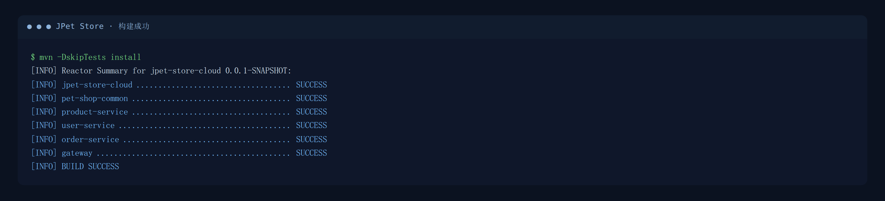

图 3-1 是 `mvn -DskipTests install` 的 Reactor Summary。`pet-shop-common`、`product-service`、`user-service`、`order-service`、`gateway` 五个模块全部 `SUCCESS`，说明公共内核安装、各模块编译与依赖解析均通过。这是后续启动四服务和截图的前提。

## 3.2 Nacos 服务注册

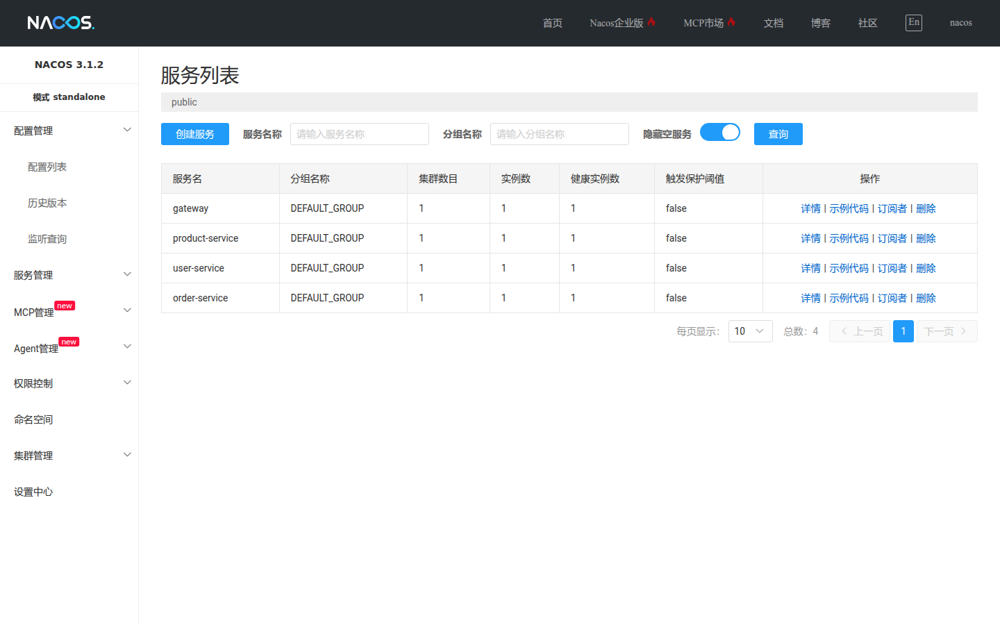

图 3-2 是 Nacos 3.1.2 控制台的“服务列表”。可以看到 `gateway`、`product-service`、`user-service`、`order-service` 四个服务，每个服务 1 个实例、1 个健康实例。说明拆分后的四个服务全部注册成功。

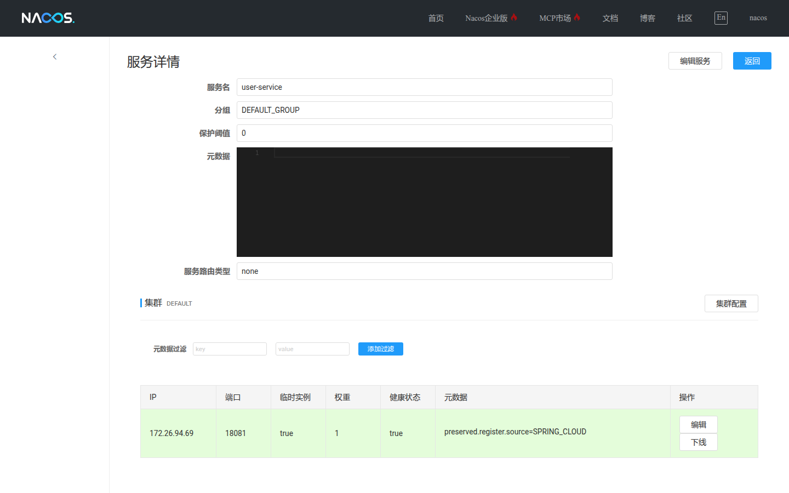

图 3-3 是 `user-service` 的实例详情：IP `172.26.94.69`、端口 `18081`、临时实例 `true`、健康状态 `true`，元数据为 `preserved.register.source=SPRING_CLOUD`。说明服务不仅注册，而且可被网关/Feign 按服务名发现。

## 3.3 网关统一入口

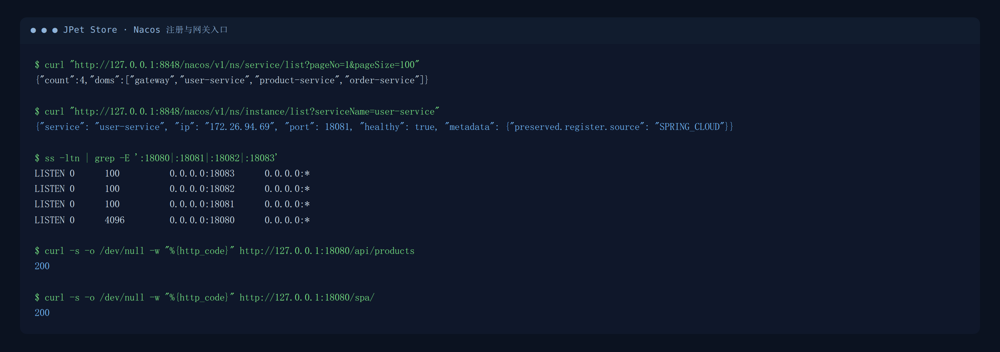

图 3-4 包含四组证据：

- Nacos 服务列表 API 返回 `count=4`，服务名为 `gateway`、`user-service`、`product-service`、`order-service`。
- `user-service` 实例 API 返回 `port=18081`、`healthy=true`。
- `ss -ltn` 显示 18080/18081/18082/18083 四个端口均在监听。
- 通过 `http://127.0.0.1:18080/api/products` 和 `http://127.0.0.1:18080/spa/` 访问均返回 `200`。

说明外部请求统一走 Spring Cloud Gateway；18081-18083 是内部服务端口，不作为对外入口。

## 3.4 OpenFeign 服务间调用

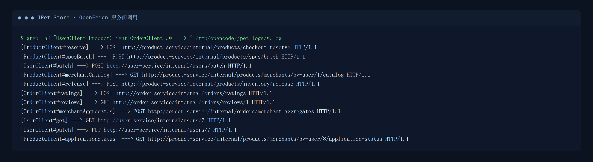

图 3-5 是 Feign 请求日志（`logger-level: full`）。可以看到四组调用关系：

- product → user：`[UserClient#get] GET http://user-service/internal/users/...`、`[UserClient#patch] PUT http://user-service/internal/users/...`
- product → order：`[OrderClient#reviews]`、`[OrderClient#ratings]`、`[OrderClient#merchantAggregates]`
- order → product：`[ProductClient#reserve]`、`[ProductClient#spusBatch]`、`[ProductClient#merchantCatalog]`、`[ProductClient#release]`
- order → user：`[UserClient#batch]`
- user → product：`[ProductClient#applicationStatus]`

所有目标地址都是 `http://<service-name>/...`，没有硬编码 IP，证明 OpenFeign + Nacos 服务名调用生效。

## 3.5 下单、发货、收货、评价与 Saga

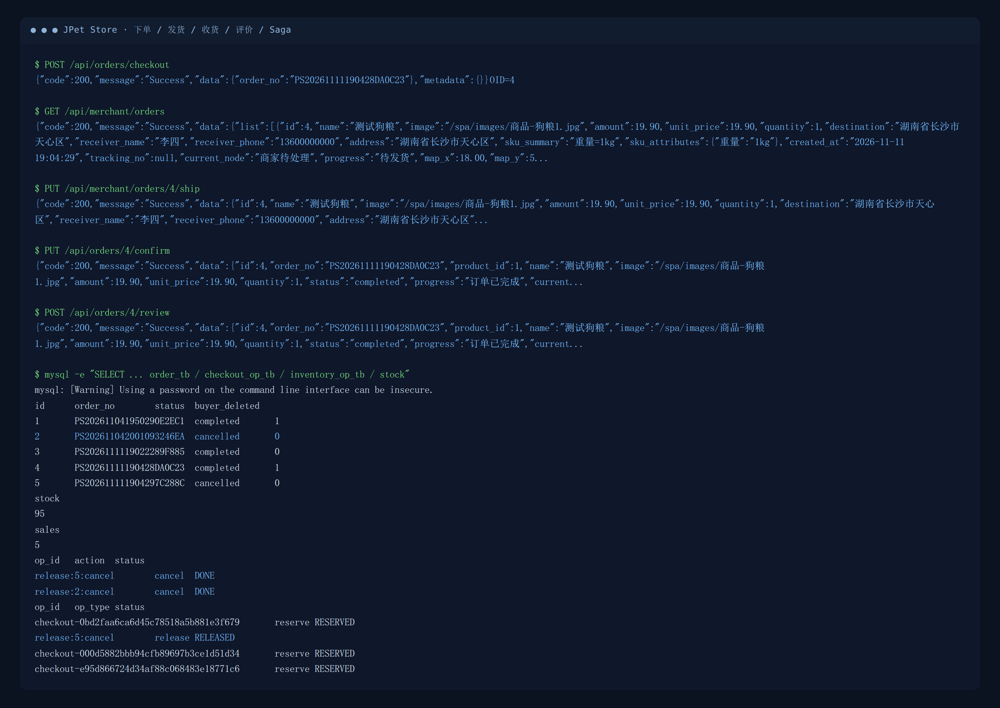

图 3-6 是一次完整订单链路和 Saga 数据：

- `POST /api/orders/checkout` 返回 `order_no=PS20261111190428DA0C23`，订单落库为 `pending`。
- `GET /api/merchant/orders` 能看到该订单，包含商品、买家、地址、SKU 属性。
- `PUT /api/merchant/orders/4/ship` 后订单变为 `shipped`，生成物流单号。
- `PUT /api/orders/4/confirm` 后订单变为 `completed`。
- `POST /api/orders/4/review` 后商家商品详情出现评价（评分 5、内容“很好”）。
- `checkout_op_tb` 状态为 `COMMITTED`，并记录 `checkout_op_id`；`inventory_op_tb` 有 `reserve / RESERVED` 和 `release / RELEASED`；`order_inventory_op_tb` 有 `release:5:cancel / DONE`；取消后库存回补、销量回退。

说明 order-service 通过 product-service 扣库存，并通过 `checkout_op_tb`、`inventory_op_tb`、`order_inventory_op_tb` 实现 Saga 状态与补偿。

## 3.6 真实 DELETE（D1–D7）

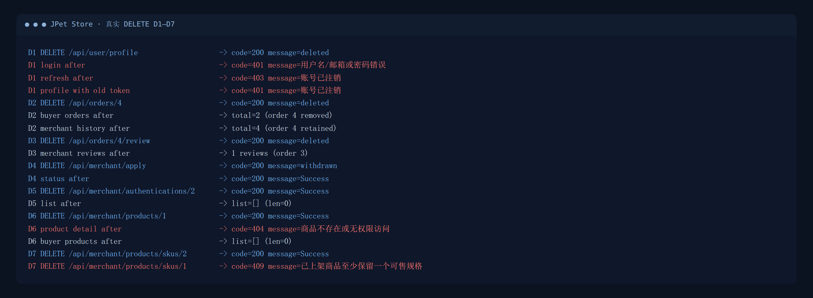

图 3-7 是 D1–D7 的实测返回：

- **D1**：`DELETE /api/user/profile` 返回 200；再次登录 401；refresh 返回 403“账号已注销”；旧 access token 访问资料返回 401“账号已注销”。
- **D2**：`DELETE /api/orders/4` 返回 200；买家订单列表 `total=2`（订单 4 被移除）；商家历史订单仍保留（买家删除只影响买家侧）。
- **D3**：`DELETE /api/orders/4/review` 返回 200；商家商品评价只剩订单 3 的一条，说明订单 4 的评价已清空。
- **D4**：`DELETE /api/merchant/apply` 返回 200；申请状态变为空，merchant 行被删除。
- **D5**：`DELETE /api/merchant/authentications/2` 返回 200；认证列表清空。
- **D6**：`DELETE /api/merchant/products/1` 返回 200；商品详情变为 404，买家商品列表不再展示。
- **D7**：删除第二个 SKU 返回 200；删除最后一个 active SKU 返回 409“已上架商品至少保留一个可售规格”。

说明 DELETE 不是占位接口，具备真实业务效果、归属校验、状态守卫和幂等。

## 3.7 管理员审核与角色同步

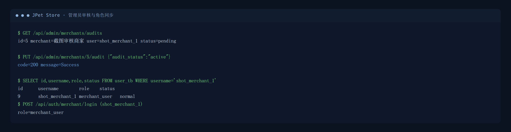

图 3-8 是管理员审核链路：

- `GET /api/admin/merchants/audits` 返回待审核申请 `id=5`、商家名“截图审核商家”、用户 `shot_merchant_1`、状态 `pending`。
- `PUT /api/admin/merchants/5/audit` 传 `{"audit_status":"active"}` 返回 200。
- `user_tb` 中 `shot_merchant_1` 的 `role` 变为 `merchant_user`，状态 `normal`。
- 该用户重新登录，返回 `role=merchant_user`。

说明 product-service 在审核通过后通过 `UserClient` 条件更新 user-service 的角色，跨服务写生效。

## 3.8 前端页面（零改动）


图 3-9 是通过网关访问 `http://127.0.0.1:18080/spa/` 的买家首页。页面正常渲染，展示“测试狗粮”（¥19.9，已售 3），说明 SPA 仍由 product-service 提供、经网关访问。

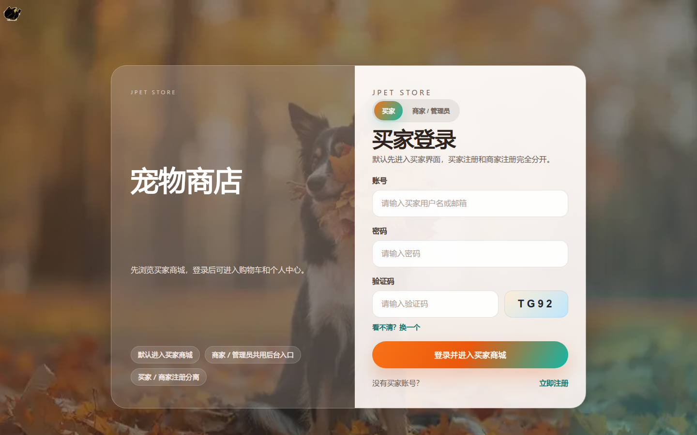

图 3-10 是统一登录页，买家/商家/管理员入口与改造前一致。前端源码未修改，外部 URL、字段和交互保持不变；变的只是 18080 后面的服务拆分与网关路由。

---

# 第四部分：实验过程中遇到的困难及解决方案、遗留问题

## 4.1 环境与依赖问题

### 4.1.1 Docker Hub 拉取超时，Nacos 镜像装不上

**现象**：`docker compose up -d` 拉取 `nacos/nacos-server:v3.1.2` 时 `TLS handshake timeout`；官方 zip 下载也多次断流。

**解决方案**：

- 使用国内镜像站 `docker.m.daocloud.io` 拉取 `nacos-server:v3.1.2-slim`，再 `docker tag` 成 compose 使用的 `nacos/nacos-server:v3.1.2`。
- 保留 compose 里的镜像名不变，避免修改项目配置。

**说明**：这是环境网络问题，不是代码问题；镜像 retag 后 compose 可正常启动。

### 4.1.2 Nacos 3.x 强制要求鉴权密钥

**现象**：Nacos 3.x 首次启动退出，报 `env NACOS_AUTH_TOKEN must be set with Base64 String`。

**解决方案**：在 `deploy/docker-compose.yml` 增加：

```yaml
NACOS_AUTH_ENABLE: "false"
NACOS_AUTH_TOKEN: "<base64 32B+ secret>"
NACOS_AUTH_IDENTITY_KEY: "jpet-server"
NACOS_AUTH_IDENTITY_VALUE: "jpet-server-value"
NACOS_CONSOLE_PORT: "8088"
```

**说明**：Nacos 3.x 即使关闭鉴权也要求 token 环境变量；控制台默认 8080 会与 gateway 冲突，所以改为 8088。

### 4.1.3 `mvn compile` 不解析 runtime/test 依赖

**现象**：`mvn -DskipTests compile` 成功，但直接 `java -jar` 或测试时缺 runtime/test 构件；`pet-shop-common` 也未 install。

**解决方案**：

```bash
mvn -DskipTests install
```

**说明**：`compile` 只解析 compile scope；`install` 才会把 common 安装到本地仓库并补齐 runtime/test 依赖。

### 4.1.4 `spring-cloud-loadbalancer` 是 optional

**现象**：Nacos discovery / OpenFeign 的 POM 中 `spring-cloud-loadbalancer` 为 `optional=true`，`lb://` 可能找不到负载均衡器。

**解决方案**：在 product/order/user/gateway 显式加入：

```xml
<dependency>
    <groupId>org.springframework.cloud</groupId>
    <artifactId>spring-cloud-starter-loadbalancer</artifactId>
</dependency>
```

---

## 4.2 网关问题

### 4.2.1 Spring Cloud Gateway 5.x 路由前缀变更

**现象**：网关启动正常，但所有 `/api/**` 返回 404。

**根因**：SCG 5.x 的路由前缀已从 `spring.cloud.gateway.routes` 改为 `spring.cloud.gateway.server.webflux.routes`；旧前缀不报错，但不会绑定路由。

**解决方案**：

```yaml
spring:
  cloud:
    gateway:
      server:
        webflux:
          routes:
            - id: user-auth
              uri: lb://user-service
              predicates:
                - Path=/api/auth/**
```

**说明**：这是本次改造中最隐蔽的问题之一；用 `spring-configuration-metadata.json` 确认了前缀。

### 4.2.2 路由顺序：商家订单必须先匹配

**现象**：`/api/merchant/orders` 被 `/api/merchant/**` 先匹配到 product-service，导致 404。

**解决方案**：把 `/api/merchant/orders/** → order-service` 放在 `/api/merchant/** → product-service` 之前。

### 4.2.3 `/internal/**` 不路由

**解决方案**：网关不配置 `/internal/**` 路由；内部接口只允许服务间通过 Nacos 服务名 + `X-Internal-Token` 调用。

---

## 4.3 序列化与 Feign 问题

### 4.3.1 Boot 4 的 Jackson 3 与项目 Jackson 2 双轨

**现象**：MVC 响应是 SNAKE_CASE（Jackson 3），但 Feign 请求体是 camelCase（Jackson 2），product 侧收到 `opId` 为空。

**根因**：Boot 4.0.4 使用 Jackson 3（`tools.jackson`），项目显式使用 Jackson 2（`com.fasterxml`）处理 `JsonNode`/`JacksonTypeHandler`；Feign 默认编码器使用了不同的 mapper。

**解决方案**：

- 共享 `AppConfig` 的 Jackson 2 `ObjectMapper` 设为 `SNAKE_CASE` + `JavaTimeModule`。
- 在 product/order/user 的 `FeignConfig` 显式注册 `JacksonEncoder`/`JacksonDecoder`，复用同一个 ObjectMapper。
- 请求拦截器补 `Content-Type: application/json`。

**说明**：内部 DTO 不使用 `LocalDateTime`/`JsonNode`，时间用 String、Map 用 `Map<String,String>`，避免序列化差异。

### 4.3.2 Feign 默认客户端不支持 PATCH

**现象**：`Invalid HTTP method: PATCH executing PATCH http://user-service/internal/users/3`。

**解决方案**：内部用户局部更新从 `PATCH` 改为 `PUT`（`/internal/users/{id}`），默认 `HttpURLConnection` 支持 PUT。

**说明**：REST 语义上 PUT 做局部更新不完全标准，但内部接口可控；如需严格 PATCH，可引入 `feign-httpclient`/`feign-okhttp`。

### 4.3.3 Feign 未设置 Content-Type

**现象**：服务端报 `Content-Type 'application/x-www-form-urlencoded;charset=UTF-8' is not supported`。

**解决方案**：`FeignConfig` 增加：

```java
@Bean
public RequestInterceptor jsonContentTypeInterceptor() {
    return template -> template.header("Content-Type", "application/json");
}
```

---

## 4.4 认证与鉴权问题

### 4.4.1 `@InjectJWTUserContext` 解析器只在 product 注册

**现象**：拆分后 user-service / order-service 的控制器拿到 null 上下文，鉴权/下单失败。

**根因**：参数解析器原来只在 product 的 `WebConfig` 注册。

**解决方案**：把注册逻辑抽到 common 的 `JwtArgumentResolverConfig`，三个 MVC 服务共用；product 的 `WebConfig` 只保留 SPA/uploads。

### 4.4.2 refresh token 复制旧角色/状态

**现象**：商家审核通过后，用旧 refresh token 刷新仍是 `normal_user`；账号注销后 refresh 仍可换新 access token。

**解决方案**：`refreshAccessToken` 按 `userId` 重新查 `user_tb`/`administrator_tb`，使用最新 role/status；deleted/banned 直接拒绝。

**说明**：这样审核通过后刷新即可拿到 `merchant_user`；注销后 refresh 立即失效（实测 403）。

### 4.4.3 内部令牌 fail-closed

**解决方案**：

- `InternalTokenFilter` 只对 `/internal/**` 生效；token 未配置返回 503，token 错误返回 401。
- 网关不路由 `/internal/**`。
- Feign 统一带 `X-Internal-Token`。

**遗留**：当前为共享静态 token；生产应使用 mTLS、按服务独立 token、轮换和审计。

---

## 4.5 数据库与实体问题

### 4.5.1 两 schema 与 product/order 共库

**方案**：`user_db`（user/administrator）与 `commerce_db`（merchant/product/order）。

**说明**：product-service 与 order-service 共用 `commerce_db`，物理上仍可互查表；本次通过“删除跨域 Mapper 引用 + 只走 Feign + grep 验收”强制逻辑边界。这是“两 schema”选择的固有代价，不是物理隔离。

### 4.5.2 初始化 SQL 中文乱码

**现象**：种子商家名/简介、用户 profile 出现乱码。

**解决方案**：`db/init/01_user_db.sql`、`02_commerce_db.sql` 顶部加 `SET NAMES utf8mb4;`，并修正已写入的数据。

### 4.5.3 `UserVo.id` 为 Integer，`User.id` 为 Long

**现象**：管理员用户列表 `id=null`，前端无法按 ID 操作。

**解决方案**：`UserVo.id` 改为 `Long`，`BeanUtils.copyProperties` 正常复制。

### 4.5.4 `updateById` 不更新 null

**现象**：D1 注销时 `profile` 置空不生效；D3 撤回评价时字段无法清空。

**解决方案**：使用 `LambdaUpdateWrapper.set(field, null)`；D1 的 `profile`、D3 的 `reviewRating/reviewContent/reviewTime` 均显式置空。

### 4.5.5 Schema 升级脚本拆分

**问题**：原 `SchemaUpgradeRunner` 同时升级 merchant_authentication 与 order 列，拆分后 product 不应再碰 order 表。

**解决方案**：

- product：`SchemaUpgradeRunner` 只保留 merchant_authentication 列 + `inventory_op_tb`。
- order：`OrderSchemaUpgradeRunner` 负责 order 列 + `buyer_deleted` + `checkout_op_id` + `checkout_op_tb` + `order_inventory_op_tb`。
- user：`UserSchemaUpgradeRunner` 负责 `user_tb.status` 增加 `deleted`。

---

## 4.6 业务一致性问题

### 4.6.1 下单跨服务事务

**问题**：单体时“扣库存 + 写订单”在一个事务；拆分后是两次服务调用。

**解决方案**：

- 订单侧 `checkout_op_tb` 状态机：`RESERVING → RESERVED → COMMITTED`；失败/超时 `COMPENSATING → COMPENSATED`。
- `order_tb.checkout_op_id` 让补偿任务判断“是否已落单”，避免“订单已落但状态未更新”被误释放。
- product 侧库存扣减改为原子条件更新：`UPDATE ... SET stock=stock-? WHERE id=? AND stock>=?`。
- `inventory_op_tb` 按 `(op_id, op_type)` 幂等；取消/退货用 `order_inventory_op_tb` 记录重试。
- 定时任务扫描 `CHECKOUT_OP` 与 `ORDER_INVENTORY_OP` 做补偿。

**遗留**：补偿极端失败仍可能留下“扣库存无订单”或“订单无库存”；没有 Seata，需要人工对账/告警。

### 4.6.2 账号注销与商家申请

**问题**：注销普通用户时，若存在 pending/rejected 商家申请，会留下孤儿 merchant 行。

**解决方案**：D1 在注销前通过 `ProductClient.applicationStatus(userId)` 检查；pending/rejected → 409，要求先 D4 撤回。

**说明**：这是 user→product 的唯一只读调用，不构成运行时递归。

### 4.6.3 D4 撤回商家申请的孤儿检查

**解决方案**：D4 只允许 pending/rejected；若存在 `merchant_authentication_tb` 或 `product_spu_tb` 关联 → 409，不做孤儿删除。

### 4.6.4 D6 删除商品后订单不可见

**问题**：商家订单列表依赖 SPU；SPU 软删后，pending/shipped 订单会消失。

**解决方案**：`spus/batch` 和 `merchantCatalog` 返回 inactive SPU；商家历史订单仍可见，买家商品列表不展示。

### 4.6.5 D7 删除最后一个 SKU

**解决方案**：新单删接口在 published SPU 只剩一个 active SKU 时返回 409；旧批量接口保持原行为。

### 4.6.6 退货后评价残留

**解决方案**：order-service 的 reviews/ratings/merchant-aggregates 统一只统计 `status=completed`；取消/退货订单的评价不再进入商品详情/评分。

### 4.6.7 商家审核角色同步

**现状**：`AdminMerchantServiceImpl.auditMerchant` 更新 merchant 后，通过 `UserDirectory.patch` 同步 `role=merchant_user`；user-service 条件更新要求 `status=normal`。

**遗留**：`merchant_role_sync_tb` 表已创建，但尚未实现定时补偿 Job；当前是同步 PUT，若 user-service 短时不可用，审核会失败/角色未同步。后续应补 outbox Job。

---

## 4.7 遗留问题清单

| # | 遗留问题 | 影响 | 建议 |
|---|---|---|---|
| 1 | product/order 共用 `commerce_db` | 边界靠代码纪律，不是物理隔离 | 后续拆 `product_db`/`order_db`，或引入 schema 权限 |
| 2 | 下单 Saga 是最终一致 | 补偿失败可能库存/订单不一致 | 增加对账任务/告警；必要时引入 Seata |
| 3 | `merchant_role_sync_tb` 未接 Job | 审核角色同步失败无法自动重试 | 实现定时 Job + 条件 PATCH + GET 复核 |
| 4 | 注销后 access token 仍有 ≤2h 窗口 | 旧 token 仍可访问部分接口 | 缩短 access TTL；或引入 token version/黑名单 |
| 5 | 内部接口共享静态 `X-Internal-Token` | 生产环境信任边界不足 | mTLS、按服务独立 token、轮换、审计 |
| 6 | `/api/cart/**` 无后端控制器 | 前端遗留调用 404（已 catch） | 补 Cart 服务或清理前端调用 |
| 7 | 新 DELETE 接口未接前端 UI | 只能 curl/Postman 验证 | 按需在商家/买家页面接入 |
| 8 | 自动化测试覆盖不足 | 主要靠手工冒烟 | 补 Controller/Service 集成测试、CI |
| 9 | 无分布式追踪/指标 | 跨服务排障困难 | 接入 Micrometer + SkyWalking/OTel |
| 10 | 无网关限流/熔断 | 单服务故障可能拖垮入口 | 增加 RateLimiter/CircuitBreaker |
| 11 | Nacos 关闭鉴权、MySQL root 密码 | 仅适合本地实验 | 生产开启鉴权、最小权限账号 |
| 12 | `MerchantUpdateDto`/`MerchantInfoVo` 未使用 | 代码冗余 | 确认无消费方后删除 |

---

## 4.8 小结

本次改造完成了：

- 单体拆分为 `user-service`、`product-service`、`order-service` 三个业务服务 + `gateway`
- 四服务注册 Nacos，按服务名访问
- 服务间 OpenFeign 调用（product↔user、order↔product/user、product↔order）
- 外部请求统一经 Spring Cloud Gateway
- 下单 Saga、库存幂等、取消/退货补偿
- D1–D7 真实 DELETE 接口
- 前端零改动，外部契约保持稳定

主要未完成项是“生产级”能力：物理分库、分布式事务/对账、outbox Job、令牌黑名单、内部 mTLS、可观测性、自动化测试与 CI。这些不影响本实验要求的服务拆分、Nacos、Feign、Gateway 演示，但应在后续迭代中补齐。

---
